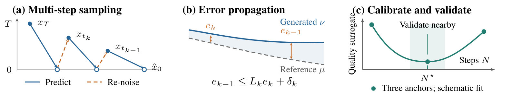
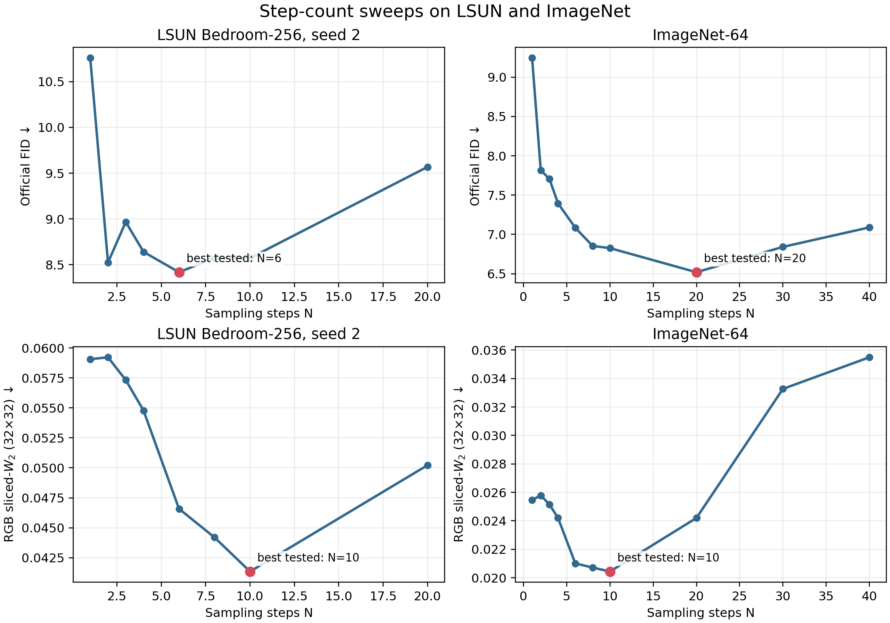

# Multi-step Consistency Models

### A Complete Error Theory and Optimal Step Selection

**NeurIPS 2026 · Poster**

**Yanshu Wang · Rui Liu · Tong Yang**  
Peking University

[Overview](#overview) · [Results](#results) · [Quick start](#quick-start) · [Reproduction guide](REPRODUCIBILITY.md) · [Validation](VALIDATION.md) · [Citation](#citation)

**How many sampling steps should a consistency model use?** More steps can initially improve generation quality, yet further steps may accumulate error and reduce quality. This repository accompanies our analysis of multi-step error propagation and model-specific step-count calibration.



*Conceptual overview, not measured data. Local transition errors propagate through the sampler; conditional analysis motivates a candidate step count that must be checked empirically.*

## Overview

The paper studies a Lipschitz-weighted Wasserstein error bound for multi-step consistency sampling and derives conditional step-count approximations. Its experiments examine whether practical samplers exhibit an intermediate-step quality basin followed by degradation.

This repository provides sampling, evaluation, and diagnostic code for the LSUN Bedroom-256 and ImageNet-64 experiments reported in the paper.

Included resources:

- Sampling and evaluation scripts for LSUN Bedroom-256 and class-conditional ImageNet-64.
- Official OpenAI FID evaluation, projected-feature paired bootstrap, pixel-space sliced-W2, and local Jacobian diagnostics.
- Compact records for **26 evaluated settings and 220,000 generated images** across three sweeps.
- A dry-run command planner, offline record checks, and scripts to regenerate the result plots.

The selected step count is a **calibration candidate, not a guaranteed optimizer of FID**. FID and reduced-resolution sliced-W2 are empirical diagnostics, not the full data-space Wasserstein distance in the theory. See [scope and limitations](REPRODUCIBILITY.md#what-this-package-does-not-establish).

## Results

### Model-specific intermediate-step optima



*Top: official FID. Bottom: RGB sliced-W2 on 32 × 32 images. The LSUN panels use the independent 5,000-sample seed; ImageNet uses 10,000 samples per step. The curves are regenerated from the archived records. Different metrics need not select the same step count.*

| Checkpoint and run | Samples per step | FID at N = 1 | Lowest tested FID | Step count at minimum |
| --- | ---: | ---: | ---: | ---: |
| LSUN Bedroom-256, primary | 10,000 | 9.535 | 7.272 | 6 |
| LSUN Bedroom-256, independent seed | 5,000 | 10.759 | 8.418 | 6 |
| ImageNet-64, class-conditional | 10,000 | 9.244 | 6.519 | 20 |

These are minima over the evaluated step counts, not certified global optima. Neighboring LSUN counts form a broad, uncertainty-overlapping basin under the projected-feature diagnostic. Full numerical records are in [`records/`](records/).

### Fixed-seed visual comparisons

| N = 1 | N = 2 |
| --- | --- |
|  |  |
| **N = 6** | **N = 20** |
|  |  |

*The first 16 samples of the primary LSUN run, without quality-based selection. Identical generator seeds align initial draws; changing the number of re-noising steps need not preserve individual image identity. These examples complement the distributional metrics rather than determine the preferred step count.*

## Quick start

### 1. Check the archived results without a GPU

Download or clone this repository and run from its root:

```bash
python verify_records.py
python -m unittest discover -s tests -v
```

The record checks use only the Python standard library. The small numerical bootstrap test additionally needs NumPy and SciPy; it is explicitly skipped if they are absent. **Record verification is not a new sampling or metric-evaluation run.**

### 2. Regenerate the result figure

```bash
python -m pip install matplotlib
python plot_records.py --input-dir records --output outputs/cross_model_step_sweep.png
```

This produces PNG and SVG plots from the bundled CSV records.

### 3. Preview a GPU experiment

```bash
python reproduce.py generate --run lsun_primary
```

By default, the runner only prints commands. To actually run the stage after preparing the environment:

```bash
python reproduce.py generate --run lsun_primary --execute
```

Supported runs are `lsun_primary`, `lsun_replicate`, and `imagenet64`. Stages include `generate`, `official`, `features`, `bootstrap`, `pixel`, and the LSUN-only `jacobian` diagnostic. Follow the [reproduction guide](REPRODUCIBILITY.md) for dependencies, reference batches, execution order, model revisions and resource requirements. Full sweeps are expensive; use the documented small smoke test first.

## Reproduction status

Offline record checks, command-planning tests, a synthetic CPU bootstrap test, and plot generation pass locally. Full CUDA generation and TensorFlow official-FID reruns remain untested in this release.

The LSUN generation revision is pinned. The original ImageNet revision and complete historical software environment were not preserved, so exact cross-environment reproduction is not guaranteed. The package does not implement a verified end-to-end reproduction of the paper's Algorithm 1 selector. See [validation details](VALIDATION.md) and [known limitations](REPRODUCIBILITY.md#what-this-package-does-not-establish).

## Repository layout

```text
assets/                       Method overview, result plots and sample grids
eval/                         Sampling and numerical evaluation code
records/                      Tables, diagnostics and per-step metadata
tests/                        Planner and small CPU numerical tests
third_party/guided_diffusion/  Official evaluator with its original license
reproduce.py                  Dry-run-first experiment launcher
verify_records.py             Offline integrity and result checks
plot_records.py               Regenerate the cross-model plots
runs.json                     Recorded experiment configurations
REPRODUCIBILITY.md             Detailed setup and execution instructions
VALIDATION.md                  Tests performed and remaining gaps
```

## Citation

```bibtex
@inproceedings{wang2026multistep,
  title     = {Multi-step Consistency Models: A Complete Error Theory and Optimal Step Selection},
  author    = {Wang, Yanshu and Liu, Rui and Yang, Tong},
  booktitle = {Advances in Neural Information Processing Systems},
  year      = {2026}
}
```

## License and acknowledgments

Our experiment code and repository helper scripts are released under the [MIT license](LICENSE), copyright 2026 Yanshu Wang, Rui Liu, and Tong Yang. Retain the copyright and permission notice when redistributing the software. If you use this work in research, please cite the paper above.

The vendored OpenAI evaluator retains its [original MIT license](third_party/guided_diffusion/LICENSE). Model weights, reference datasets and pretrained feature extractors are external assets subject to their own terms; see [asset notes](ASSETS.md). This repository includes only the small sample grids displayed in the paper, not the full generated datasets.

Peking University provided computational resources for this work. The authors declare no competing interests.

**Contact:** [yanshuwang@pku.edu.cn](mailto:yanshuwang@pku.edu.cn)
